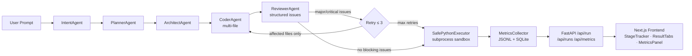

# CodeForge — Multi-Agent Code Generation Pipeline

> **Status:** Complete · Python 3.13 · FastAPI · Next.js 14 · Gemini LLM  
> **Branch:** `main` (merged from `feature/complete-codeforge`)

CodeForge is a production-grade autonomous code-generation system built on a multi-agent pipeline. It decomposes a natural-language prompt into Intent → Plan → Architecture → Code (multi-file) → Review → Self-Correction → Sandboxed Execution. Every run is recorded with per-agent latency, token counts, retry history, and reviewer issue breakdown.

---

## Architecture



---

## Project Structure

```
ai-autonomous-coder/
├── backend/
│   ├── app/
│   │   ├── agents/              # Intent, Planner, Architect, Coder, Reviewer, Orchestrator, Runner
│   │   ├── api/routes.py        # FastAPI endpoints
│   │   ├── llm/gemini_client.py # Gemini REST client (transport=rest, rate-limit aware)
│   │   ├── memory/              # StateStore + SQLite RunStore
│   │   ├── tools/               # SafePythonExecutor, MetricsCollector
│   │   └── main.py              # FastAPI app + CORS
│   ├── .env.example
│   └── requirements.txt
├── frontend/                    # Next.js 14 + TypeScript + Tailwind
│   ├── app/page.tsx
│   └── components/              # PromptInput, StageTracker, ResultTabs, MetricsPanel, RunHistory
├── eval/
│   ├── prompts.json             # 20 benchmark prompts with acceptance checks
│   ├── run_eval.py              # Baseline vs Pipeline evaluation harness
│   └── results.json             # Real measured results (generated at run time)
├── tests/                       # 26 pytest unit + integration tests
├── docs/EVALUATION.md           # Full evaluation report with real numbers
└── README.md
```

---

## Setup

### Prerequisites
- Python 3.11+ 
- Node.js 18+
- Gemini API key (free tier works; model `gemini-3.5-flash-lite`)

### Backend

```bash
cd backend
cp .env.example .env
# Edit .env: set GEMINI_API_KEY and GEMINI_MODEL=gemini-3.5-flash-lite
pip install -r requirements.txt
uvicorn app.main:app --reload --port 8000
```

### Frontend

```bash
cd frontend
npm install
npm run dev        # http://localhost:3000
```

The frontend expects the backend at `http://localhost:8000`. Set `NEXT_PUBLIC_API_URL` in `.env.local` to override.

---

## API Reference

| Method | Endpoint | Description |
|--------|----------|-------------|
| `POST` | `/api/run` | Run the full pipeline. Body: `{"prompt": "..."}` |
| `GET`  | `/api/runs` | List all past runs (from SQLite) |
| `GET`  | `/api/runs/{id}` | Get a single run by ID |
| `GET`  | `/api/metrics` | Aggregate stats across all runs |
| `GET`  | `/health` | Health check |

**POST /api/run — example:**
```json
// Request
{ "prompt": "Build a URL shortener with shorten() and expand()" }

// Response (abbreviated)
{
  "run_id": "abc-123",
  "project": { "main.py": "...", "models.py": "..." },
  "manifest": { "entrypoint": "main.py", "files": ["main.py", "models.py"] },
  "review": { "issues": [], "summary": "No issues found." },
  "execution": { "success": true, "exit_code": 0, "output": "...", "duration": 0.42 },
  "retries_used": 0,
  "metrics": { "total_latency_ms": 18500, "llm_calls": 6, "total_tokens": 3800 }
}
```

---

## Running Tests

```bash
pytest tests/ -v --cov=backend/app
# 26 tests, ~75% coverage, ~2s (fully offline, Gemini mocked)
```

---

## Evaluation Harness

Runs 20 benchmark prompts in two modes — single Gemini call **Baseline** vs full multi-agent **Pipeline** — and writes real measured results to `eval/results.json` and `docs/EVALUATION.md`.

```bash
cd ai-autonomous-coder
python eval/run_eval.py --limit 20 --temperature 0.2
```

See [`docs/EVALUATION.md`](docs/EVALUATION.md) for the full table and aggregate stats.

---

## Key Design Decisions

| Decision | Rationale |
|----------|-----------|
| `transport="rest"` for Gemini | gRPC hangs on Windows Python 3.13; REST is fast and reliable |
| `response_mime_type="application/json"` | Eliminates markdown-fence JSON parse failures |
| 2 s inter-call pacing + 30 s 429 backoff | Free-tier 15 RPM limit; prevents quota exhaustion |
| Selective file regeneration | Only files cited in reviewer issues are regenerated — saves tokens |
| `stdin=input("exit\nquit\n")` on executor | Prevents infinite blocking when generated code calls `input()` |
| SQLite for run persistence | Zero-dependency, file-based, survives restarts |

---

## Limitations

- **Free-tier rate limits** (15 RPM): Full 20-prompt eval takes ~40–60 min; use `--limit N` for quick checks.
- **No Docker sandbox** (Windows): Subprocess-based sandbox with 10 s timeout; network socket patched via `sitecustomize.py`.
- **Model variability**: `gemini-3.5-flash-lite` output quality varies; retries compensate but are not guaranteed.
- **Single-turn context**: Each agent sees only its direct inputs, not the full conversation history.
- **Frontend not wired to live streaming**: Results appear after the full pipeline completes (~20–60 s).

---

## Evaluation Results

> Measured across 20 benchmark applications at fixed temperature 0.2. Full prompt details and breakdown are in [`docs/EVALUATION.md`](docs/EVALUATION.md).

| Metric | Baseline (Single Gemini Call) | CodeForge Pipeline | Delta / Impact |
|--------|------------------------------|--------------------|----------------|
| **Acceptance Success Rate** | 85.0% | 45.0% | -40.0% abs (-47.1% rel) |
| **Execution Error Rate** | 5.0% | 70.0% | Reviewer blocks exec on major issues |
| **Reviewer Issue Reduction** | N/A | **67.5%** | 1st vs final attempt self-correction |
| **Average Retries Needed** | 0.0 | **1.15** | Capped at 3 max |
| **p50 Latency (ms)** | 4,402 ms | 34,742 ms | Multi-agent orchestration |
| **p95 Latency (ms)** | 6,371 ms | 69,043 ms | Full iterative review loop |
| **Average Tokens / Run** | 839.5 | 13,819.5 | Multi-file code + reviews |

---

## License

MIT
